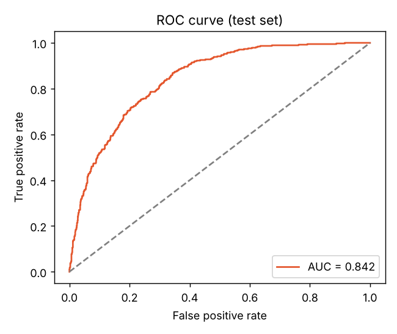
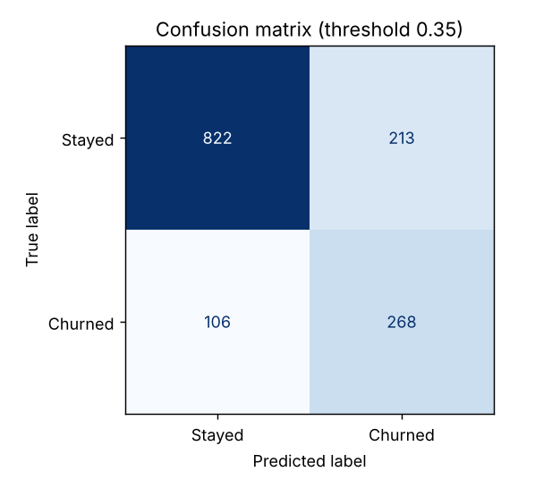
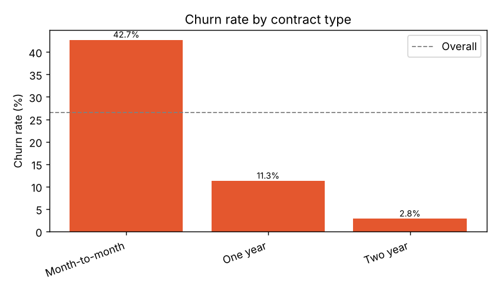
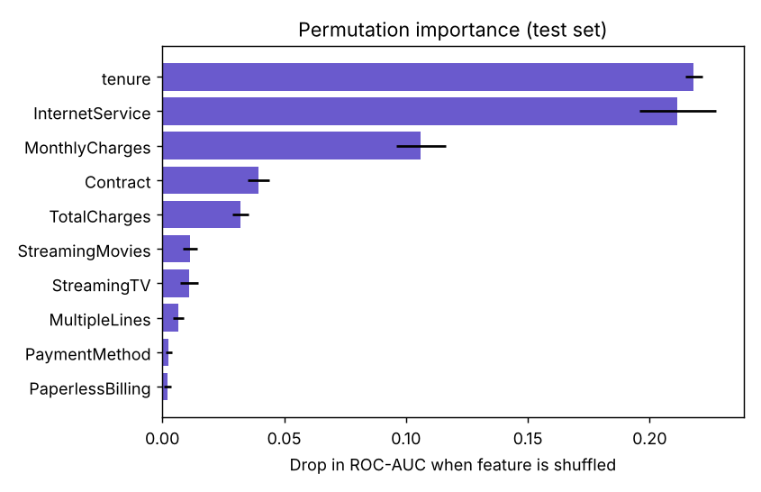
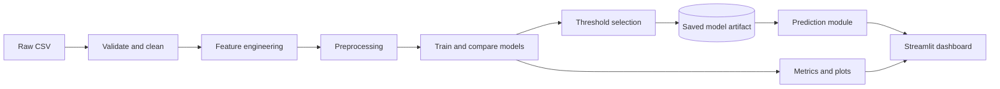

# Customer Churn Prediction

An end-to-end machine learning project that predicts which telecom customers are likely to cancel, explains why, and lets a retention team act on the results through an interactive Streamlit dashboard.

**What it covers:** data cleaning, exploratory analysis, feature engineering, model comparison with cross-validation, cost-based threshold selection, evaluation, a Streamlit app with single and batch scoring, automated tests and CI.

## Results at a glance

Evaluated on a held-out test set of 1,409 customers (374 of whom churned) that was never used for training, tuning or threshold selection.

| Metric | Value |
|---|---|
| ROC-AUC | **0.842** |
| Recall (churners caught) | **71.7%** (268 of 374) |
| Precision (flagged who really churn) | 55.7% (268 of 481) |
| F1 | 0.627 |
| Decision threshold | 0.35 (chosen by expected net benefit) |
| Selected model | Logistic Regression |

For context, always predicting "stays" would be 73.5% accurate while catching no churners, which is why accuracy is not used to judge the model.

Three algorithms were compared with 5-fold cross-validation on the training data:

| Model | CV ROC-AUC (mean ± std) |
|---|---|
| Random Forest | 0.848 ± 0.010 |
| Gradient Boosting | 0.848 ± 0.011 |
| Logistic Regression | 0.846 ± 0.012 |

The three are statistically tied, so the simplest model within one standard deviation of the best was selected (see [design decisions](#key-design-decisions)).

<p align="center">
  
  
</p>

## What the data says

From the [EDA report](docs/reports/EDA_REPORT.md) (IBM Telco sample data, 7,043 customers, 26.5% churn):

- Month-to-month contracts churn at **42.7%**, versus 11.3% for one-year and 2.8% for two-year contracts.
- Customers in their first 12 months churn at **47.4%**, versus 9.5% after four years.
- Fiber optic customers churn at 41.9%; electronic-check payers at 45.3%.

These are correlations in one company's sample data, not proof of cause.

<p align="center">
  
  
</p>

## Features

- **Overview page:** filterable KPIs and charts of churn by contract, tenure, payment method and charges.
- **Predict one customer:** a form returns the churn probability, a risk band and the factors pushing the score up or down.
- **Batch scoring:** upload a CSV, get customers ranked by risk, download the scored file. Invalid files get clear error messages.
- **Model performance:** metrics, model comparison, ROC / precision-recall / confusion matrix / feature importance, and the threshold economics.
- **Adjustable threshold** in the sidebar.

> **Screenshots:** add images of the four dashboard pages to `docs/images/` (see [User Guide](docs/USER_GUIDE.md#taking-screenshots)). The charts above are generated by the project's own scripts.

## Architecture



Details: [System Architecture](docs/SYSTEM_ARCHITECTURE.md), [High-Level Design](docs/HIGH_LEVEL_DESIGN.md), [Low-Level Design](docs/LOW_LEVEL_DESIGN.md).

## Quick start

Requires Python 3.12 (the version the project was developed and tested with).

```bash
git clone <your-repo-url> churn-prediction
cd churn-prediction
python -m venv .venv
source .venv/bin/activate          # Windows: .venv\Scripts\activate
pip install -r requirements.txt

streamlit run app/streamlit_app.py
```

The repository includes the dataset and a trained model, so the dashboard works immediately. To reproduce everything from scratch:

```bash
python scripts/download_data.py    # only if data/raw is empty
python scripts/eda.py              # figures + docs/reports/EDA_REPORT.md
python scripts/train.py            # trains, evaluates, saves model and metrics
pip install -r requirements-dev.txt
pytest                             # 43 tests
```

More detail: [Installation Guide](docs/INSTALLATION_GUIDE.md).

## Project structure

```
churn-prediction/
├── app/streamlit_app.py            # dashboard
├── src/churn_prediction/
│   ├── config.py                   # paths, columns, business assumptions
│   ├── data.py                     # load, validate, clean, split
│   ├── features.py                 # feature engineering + preprocessing
│   ├── modeling.py                 # pipelines, tuning, threshold, metrics
│   ├── evaluate.py                 # evaluation plots
│   └── predict.py                  # inference and explanations
├── scripts/                        # download_data.py, eda.py, train.py
├── tests/                          # 43 pytest tests
├── data/raw/                       # IBM Telco dataset (Apache-2.0)
├── models/churn_model.joblib       # trained artifact
├── reports/metrics.json            # saved evaluation results
├── docs/                           # documentation, EDA report, figures
├── .github/workflows/ci.yml        # lint + tests + training smoke test
├── Dockerfile, docker-compose.yml
└── requirements.txt, requirements-dev.txt, pyproject.toml
```

## Key design decisions

- **One pipeline for training and prediction.** Feature engineering and preprocessing live inside a scikit-learn `Pipeline`, so the dashboard cannot drift from what the model was trained on.
- **Honest model selection.** Cross-validated scores were within noise of each other, so the project uses a one-standard-deviation rule and picks the simplest model. This rule was adopted after seeing the tied results; the rationale is documented rather than hidden.
- **Threshold from business cost, not 0.5.** The threshold maximises expected net benefit on out-of-fold training predictions. The economics (customer value $500, offer cost $50, 30% success rate) are **illustrative assumptions** in `config.py`, not facts from the data. On the test set the gain over a 0.5 threshold is modest (about $11.46 vs $10.01 per customer under these assumptions).
- **Explanations that avoid misleading numbers.** Per-customer drivers swap groups of related features (for example tenure with total charges) rather than single columns, because correlated features otherwise produce offsetting artefacts.
- **No database or API.** The data is a single static table and the dashboard calls the prediction module directly, so adding either would be complexity without a benefit.

## Testing and quality

43 automated tests cover data validation, cleaning, feature engineering, modelling logic, inference, explanations and every dashboard page. Linting uses Ruff (including its security rules), and CI runs lint, tests and a training smoke test. See [Testing Documentation](docs/TESTING_DOCUMENTATION.md) for what was and was not verified.

## Docker

```bash
docker compose up --build   # dashboard on http://localhost:8501
```

The Dockerfile was written but **not built or run** during development (the build environment could not pull base images). Treat it as untested until you run it.

## Known limitations

- Single-company sample dataset; results may not transfer to other businesses or time periods.
- Test-set metrics come from one 80/20 split, so expect roughly ±0.02 uncertainty in AUC.
- Probabilities are not separately calibrated (Brier score on test: 0.138).
- The cost-based threshold depends entirely on the assumed economics.
- Explanations are what-if approximations, not exact attributions.
- The saved model must be loaded with the pinned scikit-learn version (1.9.1); otherwise retrain with `python scripts/train.py`. Only load model files you trained yourself, as joblib files can execute code when loaded.
- Dashboard screenshots are not included yet, and the Docker image and GitHub Actions workflow have not been run.

## Future improvements

Probability calibration, time-based validation, SHAP explanations, drift monitoring, and experiment tracking with MLflow (planned for Project 7 of the portfolio roadmap).

## Data and license

Code: [MIT](LICENSE). Data: [IBM Telco Customer Churn sample dataset](https://github.com/IBM/telco-customer-churn-on-icp4d), Apache License 2.0 (copy in `data/raw/`).
