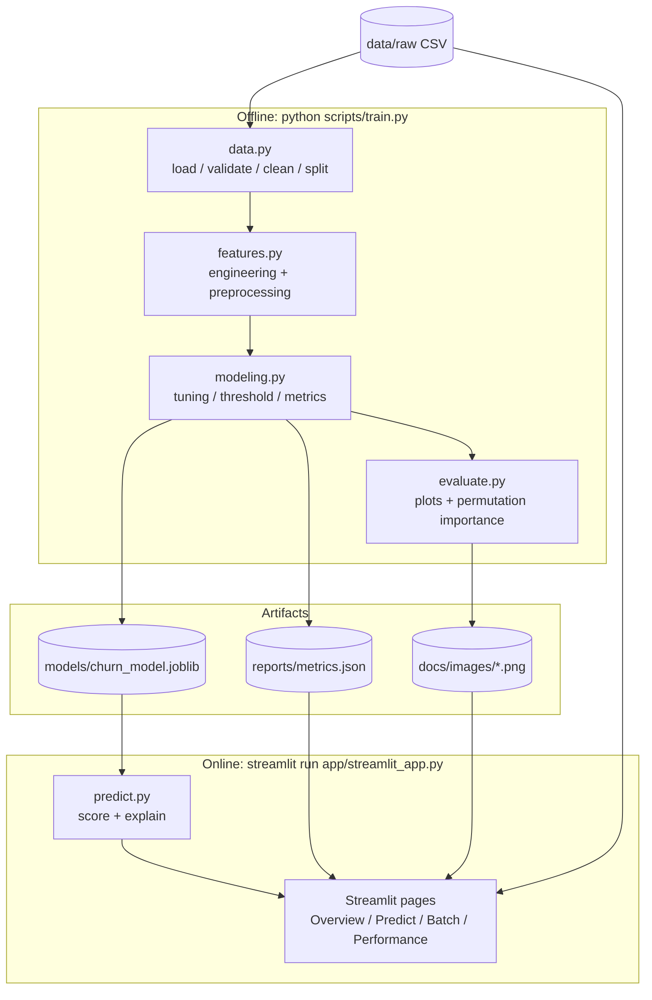
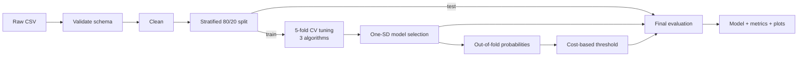

# System Architecture

## Overview
A single Python application with two entry points: an offline **training pipeline** that produces a model artifact and evaluation reports, and an online **Streamlit dashboard** that loads the artifact to score customers. There is no database, message queue or network API, because the data is one static table and the dashboard calls the prediction code directly.

## Component diagram

## Data flow

The test split is used once, after every choice (model, hyper-parameters, threshold) has been made on training data only.

## Technology stack
Python 3.12, pandas, NumPy, scikit-learn, Matplotlib, Plotly, Streamlit, joblib, pytest, Ruff, GitHub Actions, Docker (written, not built in the dev environment).

## Key architectural decisions
| Decision | Reason |
|---|---|
| Single scikit-learn `Pipeline` containing feature engineering | Guarantees training and inference use identical transformations |
| Model artifact bundles pipeline, threshold and reference values | The app needs nothing but one file, and the threshold cannot drift from the model |
| Shared `predict.py` used by the app, tests and scripts | One code path for scoring |
| Plain functions in a package (`src/` layout) | Easy to test and import without framework coupling |
| No web API or database | Not needed for a static dataset and a single-user dashboard |

## Deployment view
Locally via Streamlit; optionally as a container (`Dockerfile`) or on Streamlit Community Cloud. See the [Deployment Guide](DEPLOYMENT_GUIDE.md).

## Security considerations
- No secrets or credentials are used.
- Uploaded CSVs are parsed with pandas and validated before scoring; they are held in memory only.
- The model file is a joblib pickle, which can execute code on load. Only load model files you produced.
