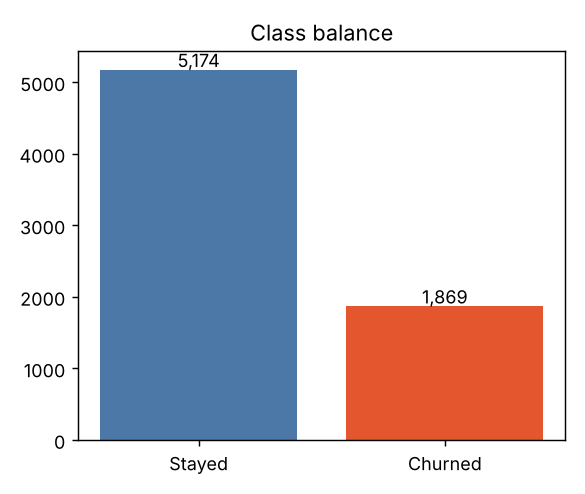
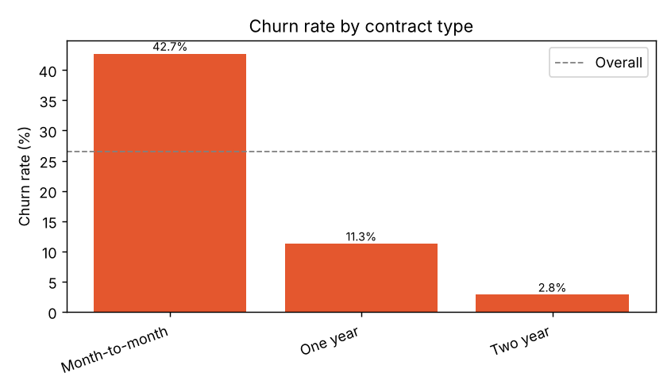
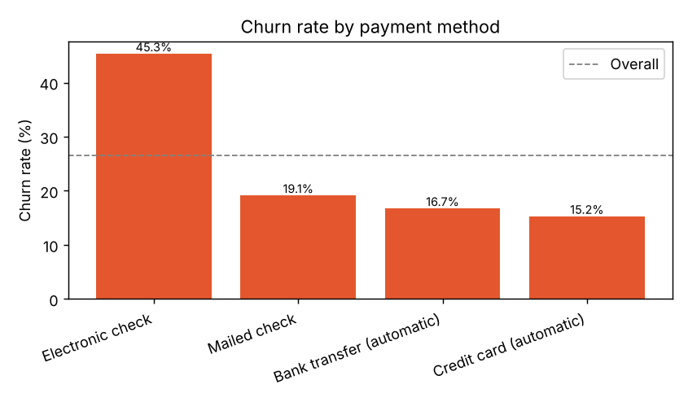
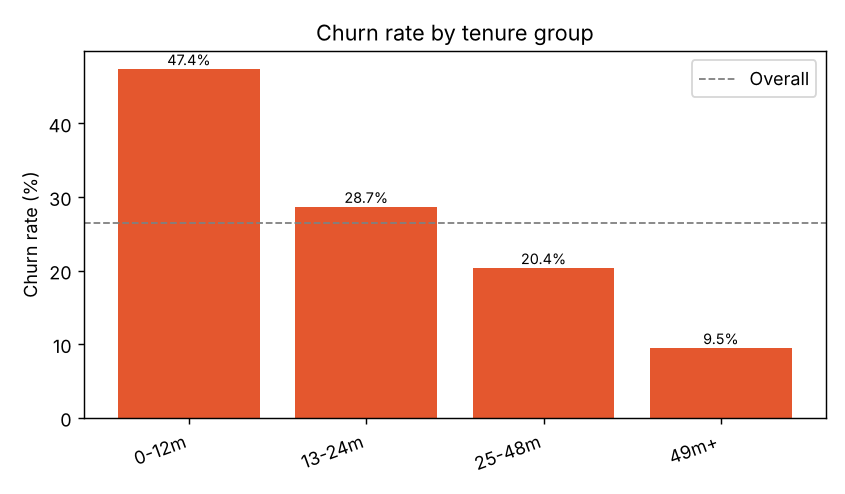
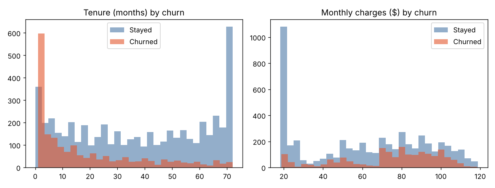
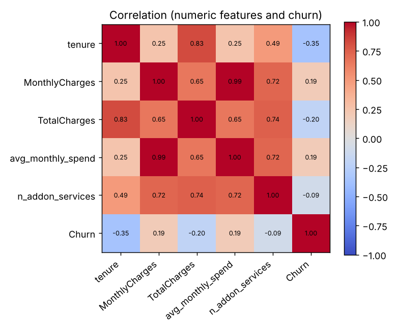

# Exploratory Data Analysis Report

*Generated by `scripts/eda.py` from the actual dataset. Re-run the script to refresh every number.*

## Dataset
- **Source:** IBM Telco Customer Churn sample dataset (Apache-2.0).
- **Rows / columns:** 7,043 customers, 21 columns.
- **Duplicate customer IDs:** 0.
- **Blank `TotalCharges` values:** 11 (all stored as text; these are customers with tenure 0, treated as 0 charges so far).
- **Churn rate:** 26.5% (1,869 churned vs 5,174 stayed), so the classes are imbalanced. Accuracy alone would be misleading, so evaluation uses ROC-AUC, precision, recall and F1.

## Churn by contract type
| Group | Customers | Churn rate |
|---|---:|---:|
| Month-to-month | 3,875 | 42.7% |
| One year | 1,473 | 11.3% |
| Two year | 1,695 | 2.8% |

Highest-churn contract: **Month-to-month** (42.7%); lowest: **Two year** (2.8%).

## Churn by internet service
| Group | Customers | Churn rate |
|---|---:|---:|
| Fiber optic | 3,096 | 41.9% |
| DSL | 2,421 | 19.0% |
| No | 1,526 | 7.4% |

## Churn by payment method
| Group | Customers | Churn rate |
|---|---:|---:|
| Electronic check | 2,365 | 45.3% |
| Mailed check | 1,612 | 19.1% |
| Bank transfer (automatic) | 1,544 | 16.7% |
| Credit card (automatic) | 1,522 | 15.2% |

## Tenure
Median tenure: **10 months** for churned customers vs **38 months** for retained ones.

| Group | Customers | Churn rate |
|---|---:|---:|
| 0-12m | 2,186 | 47.4% |
| 13-24m | 1,024 | 28.7% |
| 25-48m | 1,594 | 20.4% |
| 49m+ | 2,239 | 9.5% |

## Charges and add-on services
Median monthly charge: **$79.65** (churned) vs **$64.43** (retained).

Churn rate by number of add-on services (security, backup, protection, support, streaming):

| Group | Customers | Churn rate |
|---|---:|---:|
| 1 | 966 | 45.8% |
| 2 | 1,033 | 35.8% |
| 3 | 1,118 | 27.4% |
| 4 | 852 | 22.3% |
| 0 | 2,219 | 21.4% |
| 5 | 571 | 12.4% |
| 6 | 284 | 5.3% |

## Correlation with churn (numeric features)
- `tenure`: -0.35
- `TotalCharges`: -0.20
- `MonthlyCharges`: +0.19
- `avg_monthly_spend`: +0.19
- `n_addon_services`: -0.09

## Implications for modelling
- Use stratified splits and report metrics beyond accuracy because of the class imbalance.
- Contract type, tenure and monthly charges carry clear signal, so they are central to the feature set.
- Engineered features added to the pipeline: `avg_monthly_spend`, `n_addon_services` and `tenure_group`.
- This is correlation in one company's sample data, not proof of cause.
